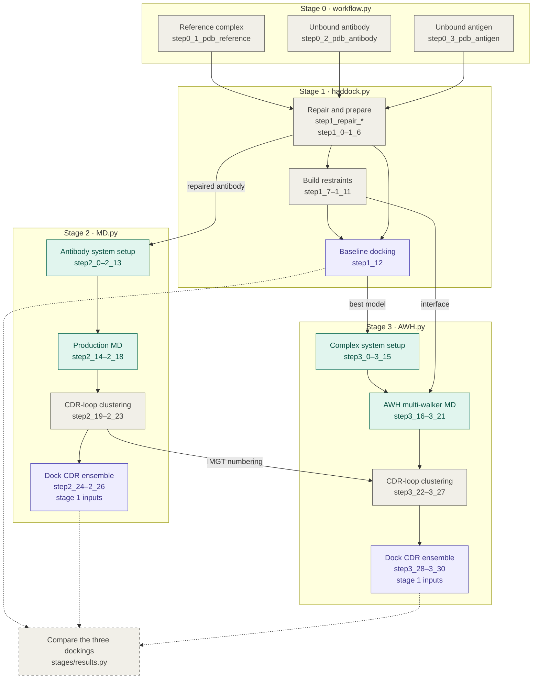

# biobb_wf_antibody

BioBB workflow for antibody–antigen docking and CDR-loop dynamics. For one
complex it runs a baseline HADDOCK3 docking, a free MD of the unbound antibody
and an AWH-MD of the best docked complex, and docks the CDR-loop ensemble each
simulation samples. One configuration file drives it all:
[`biobb_wf_antibody/config/workflow.yml`](biobb_wf_antibody/config/workflow.yml).
Running the benchmark complexes on a cluster is covered in
[`biobb_wf_antibody/array/README.md`](biobb_wf_antibody/array/README.md).

## Workflow

Each box is a range of the `step<stage>_<n>_<name>` sections of `workflow.yml`.
Labelled edges are what a stage takes from an earlier one. Both ensemble
dockings also reuse the antigen, the reference complex and the restraint tables
of stage 1, so they differ from the baseline run only in the antibody. The
dotted edges lead to `stages/results.py`, which runs separately over the
finished cases. Keep the graph in step with `workflow.yml` and
`src/antibody_wf/stages/` when a stage changes.

Grey boxes prepare or analyse structures, green ones run GROMACS and purple ones
run HADDOCK3.
